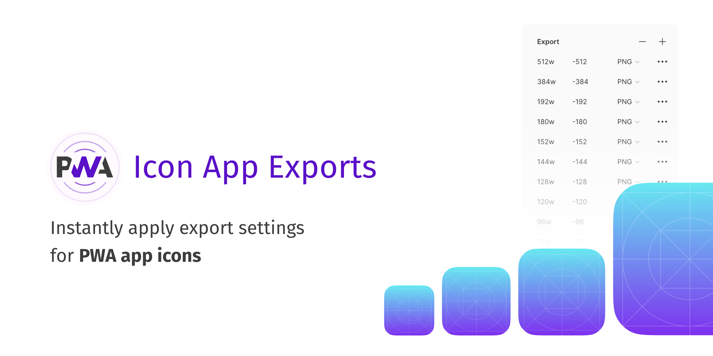

# PWA Icon App Exports 📱

A Figma plugin that prepares your app icon for a Progressive Web App: it creates ready-to-draw icon templates and adds every PWA export size to your frames in one click.

[Install on Figma](https://www.figma.com/community/plugin/771341909571444129)

## Usage

Run the plugin (`⌘ /` or `Ctrl /`, then search for “PWA Icon App Exports”) and choose **Open…**. The plugin offers two actions.

### Generate templates

Not sure where to start? This adds a section next to your existing content with one column per icon type:

1. **A guide card**: what the icon is for, how to draw it, the exported sizes, and the code that references the files.
2. **The template**: a blank 512 × 512 component with its export settings already set.
3. **An in-context preview**: the icon on a phone home screen or in a browser tab. Previews are instances of the template, so **they update live while you draw**.

| Template | Use | Preview | Exported files |
|---|---|---|---|
| `icon` | Web app manifest | Android home screen, with the white disc Android adds to non-maskable icons | `icon-72x72.png` … `icon-512x512.png` (10 sizes) |
| `icon-maskable` | Android adaptive icon. The pink layout grid shows the 80% safe zone; layout grids are never exported. | Android home screen and dock, plus circle, squircle, rounded square and teardrop masks | `icon-maskable-192x192.png`, `icon-maskable-512x512.png` |
| `apple-touch-icon` | iPhone and iPad home screen. Keep the background opaque. | iPhone-like home screen; transparent pixels show as black, as on iOS | `apple-touch-icon-152x152.png`, `-167x167`, `-180x180` |
| `favicon` | Browser tabs (transparent background) | Browser tab at 16 px, light and dark themes | `favicon-16x16.png`, `-32x32`, `-48x48`, `favicon.svg` |

Preview instances have no export settings, so exporting the page only produces the templates' files. Device and browser mockups are generic drawings, not real products.

Draw your icon in each template, then export from the **Export** section of the right panel.

### Export selected frames

Select one or more frames that already contain your icon, pick the icon sets to add, and apply. Then export from the **Export** section of the right panel.

- **Existing export settings are kept.** A setting that would produce the same image (same format and size) is replaced instead of duplicated. This also upgrades the v1 settings (`-192`) to the new names (`-192x192`).
- Exports are in **sRGB**, as expected on the web.
- You are warned when a frame is not square.

### Quick apply (no window)

The plugin menu also has **Quick apply** commands (PWA icons, Maskable, Apple touch, Favicons) that apply one icon set to the selection directly. Use `⌥ ⌘ P` (`Ctrl Alt P`) to run the last command again.

The plugin window resizes to its content. The interface and the generated guides are available in English and French. Figma does not tell plugins its own language, so the plugin starts in your system language; switch with **English / Français** at the bottom of the window, and your choice is remembered. The interface targets [RAWeb](https://accessibilite.public.lu/fr/raweb1/) / WCAG 2.1 level AA.

## Development

Requirements: Node.js 22.6 or later.

```sh
git clone https://github.com/geoffreycrofte/figma-pwa-icon-app-exports.git
cd figma-pwa-icon-app-exports
npm install
npm run build      # or: npm run watch
```

In the Figma desktop app: **Plugins › Development › Import plugin from manifest…** and select `manifest.json` at the root of the repository.

| Script | What it does |
|---|---|
| `npm run build` | Bundles `dist/code.js` (plugin) and `dist/ui.html` (interface, CSS and JS inlined) |
| `npm run watch` | Rebuilds on change |
| `npm run typecheck` | TypeScript in strict mode |
| `npm test` | Unit tests (Node test runner) |
| `npm run check` | All of the above |

### Code map

```
src/
  shared/          Pure modules, used by both sides and unit-tested
    presets.ts     Single source of truth: sizes, file names, merge rules
    messages.ts    Typed plugin ↔ UI messages and their validation
    i18n.ts        Interface text (en, fr)
    guides.ts      Text drawn on the canvas by the templates (en, fr)
  main/            Figma sandbox
    main.ts        Entry: menu commands, UI messages
    lang-preference.ts  Saved interface language (figma.clientStorage)
    apply.ts       Adds preset export settings to the selection
    selection.ts   Which layers can be exported, which are not square
    templates.ts   Lays out guides, templates and previews in a section
    canvas/        Drawing helpers: primitives, icon masks, phone and
                   browser mockups, guide cards, previews
  ui/              Plugin window
    index.html, styles.css, ui.ts
scripts/build.mjs  esbuild build
test/              Unit tests
```

## Thanks

Originally forked from [Brian Lovin’s iOS export settings plugin](https://github.com/brianlovin/figma-ios-export-settings), thanks for that ☺️
